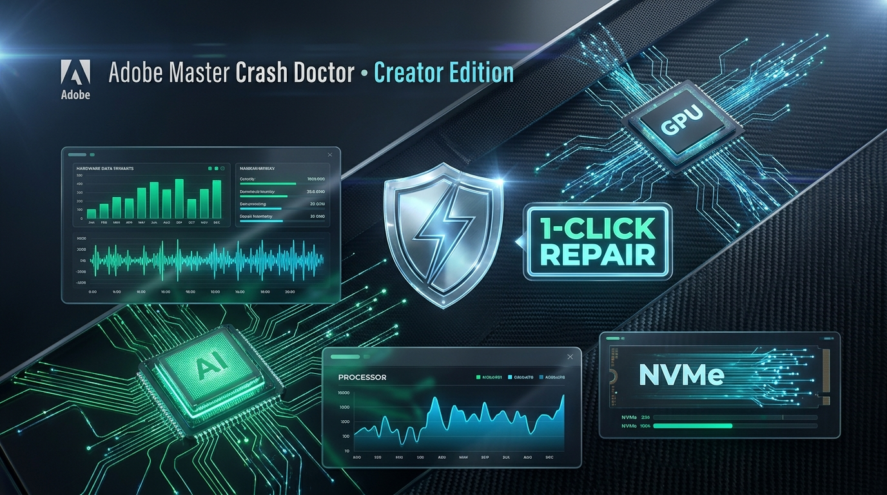
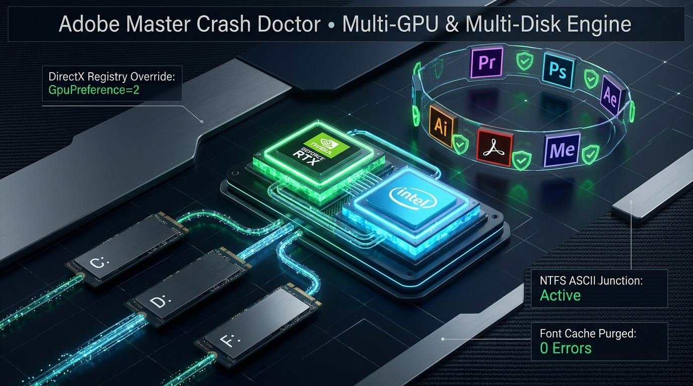

# ⚡ Adobe Master Crash Doctor • Creator Edition
> **Αυτόνομο Εργαλείο Διάγνωσης, Multi-GPU / Multi-Disk Hardware Audit & Customizable 1-Click Fix για Όλες τις Εφαρμογές Adobe**  
> *Custom δημιουργία & ανάπτυξη καθαρά στοχευμένη στην οριστική εξάλειψη των startup crashes.*



---

## 🔗 Σύνδεσμοι Έργου & Direct Download
* 🚀 **Επίσημο Web Live Landing Page (Vercel):** [**https://premiere-pro-doctor.vercel.app**](https://premiere-pro-doctor.vercel.app)
* 🌐 **GitHub Pages Mirror:** [**https://zupa212.github.io/adobe-master-crash-doctor/**](https://zupa212.github.io/adobe-master-crash-doctor/)
* **⚡ Άμεσο Download Εφαρμογής (.EXE):** [**Adobe Master Crash Doctor.exe**](https://github.com/zupa212/adobe-master-crash-doctor/raw/main/Adobe%20Master%20Crash%20Doctor.exe) *(24 MB - v1.2.2 - Zero Python Required)*
* **🎬 Άμεσο Download Premiere Launcher (.EXE):** [**Adobe Premiere Pro (Repaired).exe**](https://github.com/zupa212/adobe-master-crash-doctor/raw/main/Adobe%20Premiere%20Pro%20(Repaired).exe) *(8.4 MB)*
* **📁 Προβολή Αρχείων στο Main Branch:** [https://github.com/zupa212/adobe-master-crash-doctor/tree/main](https://github.com/zupa212/adobe-master-crash-doctor/tree/main)
* **📦 Πλήρες Αρχείο ZIP (Περιέχει και τα .EXE):** [Download Repository ZIP](https://github.com/zupa212/adobe-master-crash-doctor/archive/refs/heads/main.zip)
* **⚡ Git Clone Command:**
  ```powershell
  git clone https://github.com/zupa212/adobe-master-crash-doctor.git
  ```

---

## ⚖️ Νομική Δήλωση & Πνευματικά Δικαιώματα (Legal Disclaimer)
> [!IMPORTANT]
> **Το παρόν λογισμικό αποτελεί ανεξάρτητο custom εργαλείο εντοπισμού σφαλμάτων και τεχνικής αποκατάστασης.**  
> Όλα τα εμπορικά σήματα, λογότυπα, ονομασίες προϊόντων και πνευματικά δικαιώματα ανήκουν αποκλειστικά στην **Adobe Inc.**  
> (*Adobe®, Creative Cloud®, Premiere Pro®, Photoshop®, After Effects®, Illustrator®, Media Encoder®, Audition®, Lightroom®, InDesign®, Acrobat®*).  
> Το παρόν εργαλείο δεν αντικαθιστά τις επίσημες άδειες χρήσης και δεν τροποποιεί τα πρωτότυπα εκτελέσιμα αρχεία της Adobe Inc., αλλά επιδιορθώνει τις ρυθμίσεις του λειτουργικού συστήματος (DirectX GPU affinity, NTFS paths, Firewall rules, Font caches, AppData temp logs).

---

## 🛠️ Αρχιτεκτονική & Τηλεμετρία



---

## 🚀 Τρόποι Εκτέλεσης (Zero Python Required)

### 1. Αυτόνομο Εκτελέσιμο `.EXE` (Δεν απαιτείται εγκατάσταση Python)
- **🛡️ `Adobe Master Crash Doctor.exe`**: Πλήρης αυτόνομη σουίτα με σκοτεινό γραφικό περιβάλλον (GUI), Multi-GPU/Multi-Disk τηλεμετρία και Creative Cloud Root Cleaner.
- **🎬 `Adobe Premiere Pro (Repaired).exe`**: Άμεσο 1-Click launcher του Premiere Pro με αυτόματη παράκαμψη ελληνικών/Unicode διαδρομών (NTFS Junctions), επιβολή DirectX GPU affinity και εκτέλεση ως διαχειριστής.

> [!TIP]
> Και τα δύο εκτελέσιμα αρχεία είναι 100% αυτόνομα (standalone) με ενσωματωμένο UAC Administrator manifest και τρέχουν σε οποιονδήποτε υπολογιστή με Windows 10/11 64-bit χωρίς να χρειάζεται εγκατάσταση Python ή πρόσθετων βιβλιοθηκών!

### 2. Μέσω Desktop ή Script
- Διπλό κλικ στο **`Adobe Master Crash Doctor.exe`** στην Επιφάνεια Εργασίας.
- Ή εκτελέστε απευθείας από πηγαίο κώδικα: `python app.py`.

### 2. Μέσω Γραμμής Εντολών (CLI)
- **⚡ Πλήρης 1-Click Universal Fix (Όλες οι Εφαρμογές):**  
  ```powershell
  python cli.py --fix-all
  ```
- **🛠️ Customizable 1-Click Fix (Επιλογή Modules & Εφαρμογών):**  
  ```powershell
  # Επιλέξτε συγκεκριμένα modules: junction, gpu, fonts, cache, plugins, firewall, credentials, shortcuts
  python cli.py --custom-fix --modules fonts,cache,firewall --apps premiere,acrobat
  python cli.py --custom-fix --modules all --apps premiere,photoshop
  ```
- **🎯 Στοχευμένη Επιδιόρθωση ανά Εφαρμογή:**  
  ```powershell
  python cli.py --fix-app premiere
  python cli.py --fix-app photoshop
  python cli.py --fix-app aftereffects
  python cli.py --fix-app illustrator
  python cli.py --fix-app acrobat
  ```
- **🔍 Πλήρης Αυτόνομη Διάγνωση Συστήματος (Multi-GPU & Multi-Disk):**  
  ```powershell
  python cli.py --diagnose
  ```
- **🔥 Nuclear Root Purge (Καθαρισμός Μέχρι τη Ρίζα):**  
  ```powershell
  python cli.py --nuclear-purge
  ```
- **🗑️ Creative Cloud Root Uninstaller & Service Cleaner:**  
  ```powershell
  python cli.py --uninstall-cc
  ```
- **📡 Over-The-Air (OTA) Live Auto-Update Check & Install:**  
  ```powershell
  python cli.py --check-ota
  python cli.py --ota-update
  ```

---

## 🌟 Κύριες Δυνατότητες & Καινοτομίες

### 1. 🎮 Multi-GPU Deep Telemetry (Βλέπει Όλες τις Κάρτες Γραφικών)
Το σύστημα διαβάζει **κάθε κάρτα γραφικών** που είναι εγκατεστημένη στον υπολογιστή:
* **Αναγνώριση Hardware:** Εντοπίζει όλους τους κατασκευαστές (NVIDIA, AMD Radeon, Intel Arc/Iris/UHD).
* **Πλήρης Τηλεμετρία:** Όνομα κάρτας, Dedicated VRAM (σε GB και MB), έκδοση Driver, ημερομηνία κυκλοφορίας driver, PCI Device ID και κατάσταση λειτουργίας (Status: OK).
* **Display Mode & Active Output:** Εντοπίζει σε ποια κάρτα γραφικών είναι συνδεδεμένη η κύρια οθόνη (π.χ. `2560 x 1600 @ 60Hz`).
* **Επίλυση Συγκρούσεων Dual-GPU:** Στα συστήματα με δύο κάρτες (π.χ. NVIDIA RTX 3060 + Intel iGPU), επιβάλλει στο Windows DirectX Registry (`HKCU\Software\Microsoft\DirectX\UserGpuPreferences`) την τιμή `GpuPreference=2;` (High Performance) ώστε το Adobe GPUSniffer και το Mercury Playback να μην κρασάρουν στην εκκίνηση.

---

### 2. 💾 Multi-Disk Deep Scanner (Διαβάζει Όλους τους Δίσκους του PC)
* **Δυναμικός Εντοπισμός Όλων των Τόμων:** Εντοπίζει αυτόματα όλους τους λογικούς δίσκους (`C:`, `D:`, `F:`, εξωτερικούς σκληρούς δίσκους USB, NVMe SSDs).
* **Τηλεμετρία Χώρου & Τύπου Δίσκου:** Εμφανίζει Volume Label (`Windows-SSD`, `OS`, `BACKUP`), File System (`NTFS`, `exFAT`), καθώς και Free / Total GB.
* **Βαθύς Αναδρομικός Έλεγχος (Depth 3):** Σαρώνει όλους τους δίσκους για εγκατεστημένες εφαρμογές Adobe, repacks και διασκορπισμένες cache.
* **Αυτόματη Δημιουργία NTFS ASCII Junctions:** Εάν κάποια εφαρμογή έχει εγκατασταθεί σε φάκελο με ελληνικούς ή μη-ASCII χαρακτήρες (π.χ. `F:\Νέος φάκελος (2)\...`), δημιουργεί άμεσα καθαρό NTFS Junction στον ίδιο δίσκο (π.χ. `F:\AdobePremierePro2026`) χωρίς να απαιτείται μετακίνηση ή αντιγραφή gigabytes δεδομένων!

---

### 3. 🛠️ Customizable 1-Click Fix Engine
Στο Tab **`⚡ Custom 1-Click Fix`**, ο χρήστης μπορεί να επιλέξει ακριβώς ποια modules θα εκτελεστούν:
1. ☑️ **Kill Lingering Processes:** Ασφαλής τερματισμός κολλημένων processes (GPUSniffer, dynamiclinkmanager κ.α.).
2. ☑️ **Create NTFS ASCII Junctions:** Παράκαμψη μη-λατινικών χαρακτήρων διαδρομής.
3. ☑️ **High-Perf GPU Affinity (Registry):** Εγγραφή `GpuPreference=2;` για όλα τα Adobe exes.
4. ☑️ **Purge Font Caches:** Διαγραφή αλλοιωμένων `AdobeFnt*.lst` και `.db` (αποτρέπει σιωπηρά κρασαρίσματα σε Photoshop, Illustrator, Premiere).
5. ☑️ **Purge Media & Scratch Caches:** Εκκαθάριση `.ims`, `.pek`, `.cfa`, CameraRaw και temp αρχείων σε όλους τους δίσκους.
6. ☑️ **Reset Plugin DBs (Auto-Backup):** Μηδενισμός `Plugin Loading.log` και `AudioPluginManagerSettings.xml` με αυτόματο backup.
7. ☑️ **Windows Firewall Loopback Rules:** Ρύθμιση κανόνων 127.0.0.1 για άμεση επικοινωνία εσωτερικών sockets.
8. ☑️ **Purge Stale Credential Vault:** Καθαρισμός παλιών tokens στο Windows Credential Manager.
9. ☑️ **Create Repaired Desktop Shortcuts:** Δημιουργία έτοιμης συντόμευσης στην Επιφάνεια Εργασίας.

---

### 4. 🧊 Premiere Pro 2-Minute Anti-Freeze & Audio/GPU Protocol (Οριστική Επίλυση Παγώματος στα 2 Λεπτά)
Όταν το Premiere Pro ανοίγει κανονικά αλλά μετά από ακριβώς **2 λεπτά (120 δευτερόλεπτα)** παγώνει και μπαίνει σε κατάσταση **"Not Responding" (AppHang)**, το πρόβλημα οφείλεται σε 4 τεκμηριωμένους μηχανισμούς συγχρονισμού:
1. **Audio Device Sleep Deadlock (Το περίφημο "Default Input" Bug):**  
   Το Premiere Pro διατηρεί μόνιμα ανοιχτό κανάλι με το προεπιλεγμένο μικρόφωνο (`dvaaudiodevice.AlwaysRunning=true`). Όταν η συσκευή ήχου μπαίνει σε power-saving sleep, το main thread παγώνει περιμένοντας απάντηση.  
   *Επίλυση:* Παραμετροποίηση `dvaaudiodevice.AlwaysRunning false false` και `AudioOutputOnlyUI true true` στο `Debug Database.txt`.
2. **Σύγκρουση Hardware Decoding σε Dual-GPU Συστήματα:**  
   Σε υπολογιστές με επεξεργαστή Intel Core Ultra (Intel Arc/Iris iGPU) και NVIDIA GeForce RTX 3060, το Premiere Pro επιχειρεί να αποκωδικοποιήσει H.264/HEVC ταυτόχρονα και από τις δύο κάρτες (`EnableIntelDecode=true` & `EnableNvidiaDecode=true`), προκαλώντας DirectX DXGI Device Reset deadlock μετά από 1-2 λεπτά.  
   *Επίλυση:* Απενεργοποίηση Intel iGPU decoding και επιβολή αποκλειστικής χρήσης του NVIDIA RTX 3060 NVDEC accelerator στο `Adobe Premiere Pro Prefs`.
3. **120-Second IPC Cloud Handshake Timeout:**  
   Τα παρασκηνιακά daemons (`AdobeCollabSync.exe`, `CCXProcess.exe`, `AdobeNotificationClient.exe`) προσπαθούν να επικοινωνήσουν με cloud endpoints μέσω local sockets. Στα 120s (default TCP socket timeout), αν δεν υπάρξει απάντηση, η εφαρμογή παγώνει.  
   *Επίλυση:* Τερματισμός των daemons και απενεργοποίηση background sync (`TeamProjects.DisableBackgroundSync true true`).
4. **Windows GPU TDR Delay Boost (10 δευτερόλεπτα):**  
   Αύξηση του `TdrDelay` και `TdrDdiDelay` από 2s σε 10s στο `HKLM\SYSTEM\CurrentControlSet\Control\GraphicsDrivers` ώστε τα Windows να μην τερματίζουν τον driver της κάρτας γραφικών κατά την αναπαραγωγή στο timeline.

---

### 5. 🎯 App-Specific Doctor (Υποστηριζόμενες Εφαρμογές)
* 🎬 **Adobe Premiere Pro** (Video Editing)
* 🎨 **Adobe Photoshop** (Raster Graphics)
* ✨ **Adobe After Effects** (VFX & Motion Graphics)
* 📐 **Adobe Illustrator** (Vector Design)
* 🎞️ **Adobe Media Encoder** (Rendering & Transcoding)
* 📄 **Adobe Acrobat DC** (PDF Documents)
* 🎙️ **Adobe Audition** (Digital Audio Workstation)
* 📷 **Adobe Lightroom Classic** (Photo Development)
* 📰 **Adobe InDesign** (Page Layout & Typography)
* 🧊 **Adobe Substance 3D Suite** (3D Materials & Texturing)

---

### 6. 🗑️ Creative Cloud Root Uninstaller & Service Cleaner
* Τερματισμός όλων των παρασκηνιακών διεργασιών.
* Οριστική διαγραφή Windows Services: `AdobeUpdateService`, `AGSService`, `AdobeARMservice`.
* Αφαίρεση Scheduled Tasks και Startup Run keys.
* Αυτόματη λήψη & εκτέλεση του επίσημου **Adobe Creative Cloud Cleaner Tool** σε silent mode (`--eulaAccepted=1 --removeAll=ALL`).
* Εκκαθάριση φακέλων `OOBE`, `SLStore`, `SLData` και `Creative Cloud Libraries`.

---

### 7. 📡 OTA (Over-The-Air) Live Auto-Updater Engine
Η εφαρμογή διαθέτει ενσωματωμένο σύστημα αυτόματων Over-The-Air (OTA) ενημερώσεων:
* **Αυτόματος Έλεγχος στο Παρασκήνιο:** Ελέγχει αυτόματα στο GitHub (`version.json` & GitHub Releases API) κατά την εκκίνηση.
* **1-Click In-App Update:** Όταν κυκλοφορεί νέα έκδοση ή επιδιορθώσεις, εμφανίζει ένδειξη και επιτρέπει άμεση λήψη και εγκατάσταση με 1 κλικ μέσα από το GUI χωρίς να χρειάζεται χειροκίνητο download από browser.
* **Ασφαλής Επανεκκίνηση:** Χρησιμοποιεί detached background updater script για ασφαλή αντικατάσταση του εκτελέσιμου αρχείου και αυτόματη επανεκκίνηση της νέας έκδοσης!
